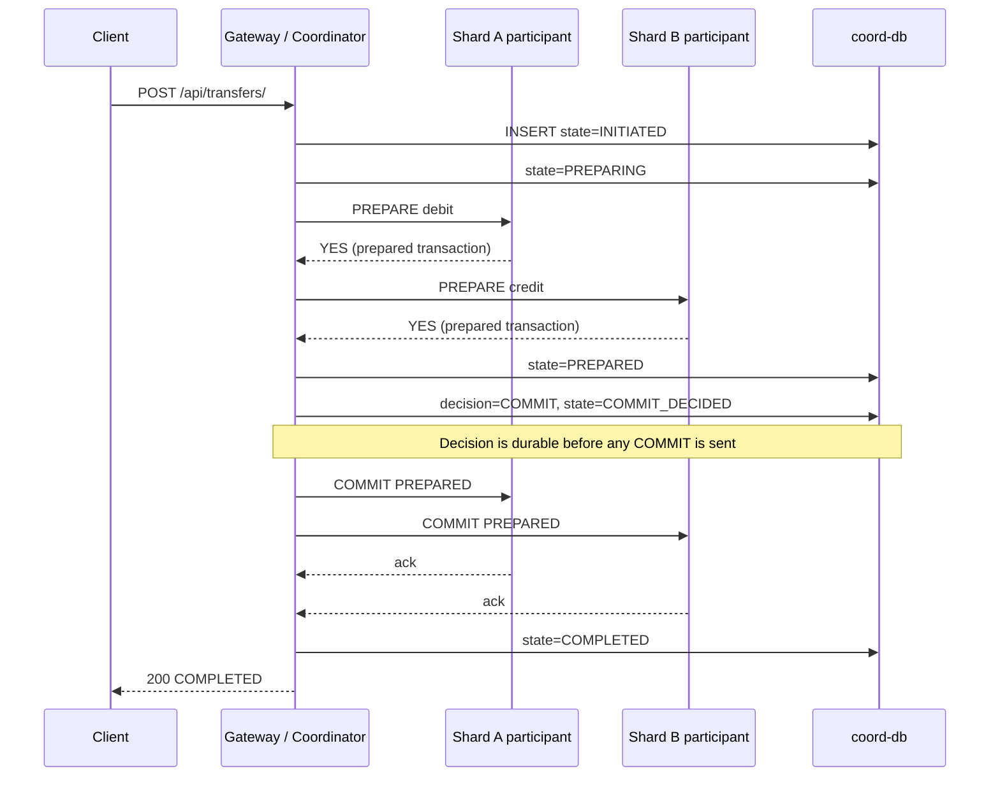
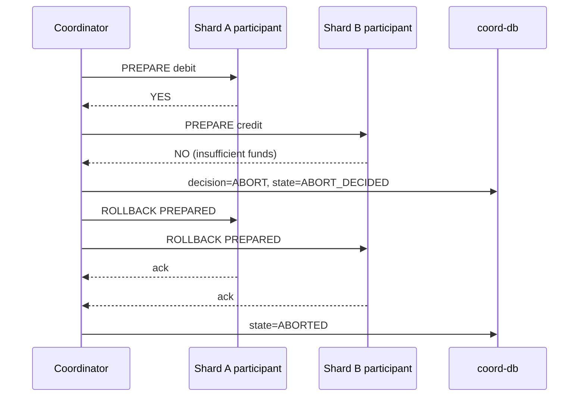

# Distributed Banking Platform

A sharded, replicated banking platform with a shard-aware gateway and a durable
two-phase-commit (2PC) coordinator, built for **Assignment 2: Sharding,
Replication & Distributed Transactions**.

The platform runs entirely with Docker Compose on one host:

- **2 independent shards**, each with its own PostgreSQL database and **2
  application replicas**.
- A **gateway** that maps every account to its owning shard, load-balances over
  healthy replicas, and is the only client-facing entry point.
- A **durable 2PC coordinator** inside the gateway that coordinates cross-shard
  transfers through PostgreSQL prepared transactions.
- A **banking client** that knows nothing about shards or replicas.

---

## Contents

- [Architecture](#architecture)
- [Account ranges and shard map](#account-ranges-and-shard-map)
- [Request flow](#request-flow)
- [Consistency and concurrency control](#consistency-and-concurrency-control)
- [Gateway routing and replica health](#gateway-routing-and-replica-health)
- [Two-phase commit coordinator](#two-phase-commit-coordinator)
- [Recovery scenarios](#recovery-scenarios)
- [Project structure](#project-structure)
- [Configuration](#configuration)
- [Running the platform](#running-the-platform)
- [API reference](#api-reference)
- [Client test suite](#client-test-suite)
- [Required experiments](#required-experiments)
- [Inspecting state](#inspecting-state)
- [Troubleshooting](#troubleshooting)
- [Known limitations](#known-limitations)

---

## Architecture

```
                          +--------------------------------------+
   banking client  ---->  | Gateway (FastAPI)                    |
   `client test/`         |   - account -> shard routing         |
                          |   - round-robin replica selection    |
                          |   - health probing                  |
                          |   - 2PC coordinator (in-process)     |
                          +----+-------------+-------------+-----+
                               |             |             |
                +--------------+             |             +--------------+
                |                            |                            |
         +------v-------+            +-------v------+            +--------v-------+
         | api-a1       |            | api-b1       |            | coord-db       |
         | api-a2       |            | api-b2       |            | banking_coord  |
         | (shard-a)    |            | (shard-b)    |            | 2PC decision   |
         +------+-------+            +-------+------+            | log            |
                |                            |                   +----------------+
         +------v-------+            +-------v------+
         | db-a         |            | db-b         |
         | A0001-A1000  |            | A1001-A2000  |
         | PostgreSQL 16|            | PostgreSQL 16|
         +--------------+            +--------------+
```

| Component | Implementation | Responsibility |
|---|---|---|
| Banking client | `client test/client.py` | Balance, deposit, withdraw, transfer. Talks only to the gateway. |
| Gateway | `gateway/main.py`, FastAPI | Shard selection, replica selection, health checks, proxying, transfer entry point. |
| Coordinator | `gateway/coordinator.py` | Transaction IDs, prepare/commit, durable decisions, recovery. |
| Banking shard | `transactions/` (Django + DRF) | Owns one account range; two replicas share one database. |
| Shard map | `config/shard_map.yaml` | Single source of truth for account ownership. |
| Replica config | `config/gateway.yaml` | Replica URLs and health thresholds. |
| Coordinator log | `coord-db` (`banking_coord`) | Durable 2PC state machine and decisions. |

### Why the coordinator has its own database

The coordinator decision log is deliberately **not** stored in either shard
database. Once a `COMMIT` decision is recorded it must remain readable and
completable even when a participant shard is unavailable. Putting the log in a
third database makes that guarantee independent of both shards.

The assignment allows the coordinator to share a container with the gateway as
long as responsibilities stay logically separate; they are separated here into
`gateway/main.py` (HTTP/API) and `gateway/coordinator.py` (protocol and durable
state).

---

## Account ranges and shard map

`config/shard_map.yaml`:

```yaml
version: 1
epoch: 1

ranges:
  - start: A0001
    end: A1000
    shard_id: shard-a
  - start: A1001
    end: A2000
    shard_id: shard-b
```

- **Shard A:** accounts `A0001`-`A1000`, served by `api-a1` and `api-a2`,
  persisted in `db-a` (database `banking_a`).
- **Shard B:** accounts `A1001`-`A2000`, served by `api-b1` and `api-b2`,
  persisted in `db-b` (database `banking_b`).

The map is validated at startup by both the gateway and the shard replicas:
ranges must be well-formed, sorted, contiguous, non-overlapping, and every
configured `SHARD_ID` must own at least one range. An account has exactly one
authoritative shard, and the full dataset is never copied between shards.

Each shard also rejects accounts outside its own range with `404
UNKNOWN_ACCOUNT`, so a replica can never serve another shard's data.

Useful accounts for demos:

| Purpose | Accounts | Shard |
|---|---|---|
| Local transfer | `A1001` -> `A1002` | both shard B |
| Cross-shard transfer | `A1001` -> `A0501` | B -> A |
| Cross-shard reverse | `A0501` -> `A1001` | A -> B |

---

## Request flow

### Balance, deposit, withdraw

1. The client sends the request to the gateway.
2. The gateway resolves the account to its shard using `shard_map.yaml`.
3. The gateway selects a healthy replica of that shard (round-robin).
4. The replica executes the operation against the shard database with
   `SELECT ... FOR UPDATE` and a single atomic transaction.

Read requests may be retried once on a different healthy replica. Writes are
not silently retried by the gateway, because a lost response could otherwise
produce a duplicate deposit or withdrawal.

### Same-shard transfer

1. The gateway sees that both accounts belong to the same shard.
2. It selects one healthy replica of that shard.
3. That replica runs **one local database transaction**:
   both rows are locked in ascending account-number order, the debit and credit
   are applied, and the transaction commits or rolls back as a unit.
4. The response contains `"mode": "local"`.

No coordinator is involved, because a single PostgreSQL transaction already
provides atomicity.

### Cross-shard transfer

1. The gateway sees two different shards and invokes the coordinator.
2. The coordinator creates a durable transaction row (`INITIATED`).
3. It prepares the debit participant, then the credit participant.
4. If both vote `YES`, it records a durable `COMMIT` decision **before**
   sending any `COMMIT PREPARED`.
5. It commits both participants, waits for both acknowledgements, and only then
   records `COMPLETED`.
6. If any participant votes `NO`, it records `ABORT` and rolls back all prepared
   participants.
7. The response contains `"mode": "cross-shard"` and a `txid` that can be
   queried through `GET /api/transactions/{txid}`.

### Two-phase commit sequence



If a participant votes `NO`:



Participants are prepared **sequentially in ascending account-number order**.
This gives both databases the same global lock order, so concurrent
opposite-direction transfers cannot deadlock during prepare. Commit and
rollback are sent concurrently because no ordering is required there.

---

## Consistency and concurrency control

- **Row-level locking.** Deposits, withdrawals, local transfers, and prepares
  use `SELECT ... FOR UPDATE` inside `transaction.atomic()`. Concurrent
  operations on the same account serialize on that row, so no lost updates are
  possible even when requests arrive through different replicas.
- **Global lock order.** Any operation touching two accounts locks them in
  ascending account-number order. This applies to local transfers, to prepare
  order across shards, and therefore to concurrent opposite-direction transfers.
- **Balance constraint.** The database enforces `balance >= 0` with a check
  constraint; the application additionally rejects overdrafts before writing.
- **Atomic local transfers.** Both updates happen in one database transaction.
- **Atomic distributed transfers.** 2PC with PostgreSQL prepared transactions
  (`max_prepared_transactions=64` on both shard databases).
- **Idempotent participant operations.** A `ParticipantCommit` row records
  durable commits. Repeated `COMMIT`/`ROLLBACK`/status calls for the same GID
  are safe, and a late `ROLLBACK` cannot undo a recorded commit.
- **Client request IDs.** Cross-shard transfers accept an optional
  `request_id`. Repeating the same request returns the existing transaction and
  does not move money twice. Reusing a `request_id` with different parameters
  returns `409 REQUEST_ID_CONFLICT`.

---

## Gateway routing and replica health

Replica selection is **round-robin per shard** over replicas currently marked
healthy (`gateway/balancer.py`).

Health probing:

| Setting | Default | Meaning |
|---|---|---|
| `interval_seconds` | `2` | Probe period for every replica. |
| `timeout_seconds` | `1` | Per-probe timeout. |
| `failures_to_unhealthy` | `2` | Consecutive failed probes before ejection. |
| `successes_to_healthy` | `3` | Consecutive successes before re-admission. |
| `request_timeout_seconds` | `5` | Timeout for one proxied banking request. |

A fresh replica becomes usable after its first successful probe rather than
waiting for three successes. A failed proxied request records a health failure;
after the configured threshold the replica is ejected, and the gateway retries
the request on another healthy replica where retrying is safe (balance reads).

`GET /health` reports each shard's healthy and unhealthy replicas plus the
coordinator database state. The gateway is `degraded` if any shard has no
healthy replica or if `coord-db` is unavailable.

---

## Two-phase commit coordinator

### Durable state machine

| State | Meaning | Decision |
|---|---|---|
| `INITIATED` | Row created; prepare has not started. | none |
| `PREPARING` | Prepare RPCs are in progress. | none |
| `PREPARED` | All participants voted `YES`. | none |
| `COMMIT_DECIDED` | Durable commit decision recorded. | `COMMIT` |
| `ABORT_DECIDED` | Durable abort decision recorded. | `ABORT` |
| `COMPLETED` | Both participants acknowledged the commit. | `COMMIT` |
| `ABORTED` | All participants rolled back. | `ABORT` |

The coordinator enforces these invariants:

- `COMMIT_DECIDED` is persisted **before** any `COMMIT PREPARED` is sent.
- An existing decision is **never overwritten**.
- `COMPLETED` is written only after **both** participants acknowledge.
- Recovery never turns a durable `COMMIT` into an `ABORT`.
- A response is `PENDING` (`202`) until the outcome is known; clients query
  `GET /api/transactions/{txid}` for the final state.

### Timeouts

| Setting | Default | Purpose |
|---|---|---|
| `COORD_RPC_TIMEOUT_SECONDS` | `6` | Timeout for one participant RPC. |
| `COORD_RPC_ATTEMPTS` | `2` | Attempts for idempotent participant calls. |
| `PREPARE_LOCK_TIMEOUT_MS` | `2000` | Row-lock bound inside a prepare; timeout votes `NO` (`LOCK_TIMEOUT`). |
| `PREPARE_STATEMENT_TIMEOUT_MS` | `4000` | Whole-prepare bound (`PREPARE_TIMEOUT`); must stay below the RPC timeout. |
| `COORD_RECOVERY_INTERVAL_SECONDS` | `5` | Recovery sweep period. |
| `COORD_PREPARING_GRACE_SECONDS` | `12` | How long a `PREPARING` row may be young before recovery aborts it. |

The participant's statement timeout is intentionally shorter than the
coordinator's RPC timeout. After an RPC timeout the coordinator queries the
participant's prepared-transaction state; the bound guarantees no prepare is
still running when a rollback is sent, so an orphaned prepared transaction
cannot be left behind.

Coordinator database operations are also bounded (`4s` per operation, `2s` for
health). A `coord-db` outage therefore returns `503 COORDINATOR_UNAVAILABLE`
quickly instead of hanging, while the recovery loop logs one
`coordinator recovery paused` warning and resumes once the database returns.

### Recovery rules

On each sweep, the coordinator takes every unresolved row and:

| Observed state | Action |
|---|---|
| `COMMIT_DECIDED` | Re-send `COMMIT PREPARED` until both participants acknowledge, then mark `COMPLETED`. Never aborts. |
| `ABORT_DECIDED` | Re-send `ROLLBACK PREPARED` until both acknowledge, then mark `ABORTED`. |
| `PREPARED` with no decision | Presumed abort; roll back all participants (`RECOVERED_UNDECIDED`). |
| `PREPARING`, younger than grace | Skip; the original request may still be progressing. |
| `PREPARING`, older than grace | Roll back and record abort (`RECOVERED_PREPARING`). |
| `INITIATED` | Roll back and record abort (`RECOVERED_INITIATED`). |

---

## Recovery scenarios

### Scenario A - one shard votes `YES`, another rejects

- The accepting participant may be prepared, but no decision exists.
- The coordinator records `ABORT_DECIDED` and rolls back every participant that
  may have prepared.
- Both balances remain unchanged.

This is covered by **Stage 7** of the client (over-balance cross-shard
transfer) and by Experiment 5. Manual trigger - the credit participant prepares
first (`A0501` < `A1001`), then the debit participant votes `NO`:

```bash
curl -s -i -X POST http://127.0.0.1:8000/api/transfers/ \
  -H "Content-Type: application/json" \
  -d '{"from_account":"A1001","to_account":"A0501","amount":"999999.00"}'
```

The response is `422 INSUFFICIENT_FUNDS` with state `ABORTED`, and both
balances are unchanged.

### Scenario B - all participants prepared, coordinator stops

- Both participants hold prepared transactions; no durable decision exists.
- After restart, recovery sees `PREPARED` without a decision and performs a
  safe abort (`RECOVERED_UNDECIDED`). No money moves, and both prepared
  transactions are resolved.
- A long-running `PREPARING` row is treated the same way after the grace period.

Manual trigger:

```powershell
# Terminal 1: start the gateway with a pause after both prepares
$env:COORD_TEST_PAUSE_AFTER_PREPARE_SECONDS = "30"
docker compose up -d gateway

# Terminal 2: send a cross-shard transfer; it blocks during the pause
$body = @{
  from_account = "A1001"
  to_account   = "A0501"
  amount       = "1.00"
} | ConvertTo-Json
Invoke-RestMethod -Uri http://127.0.0.1:8000/api/transfers/ `
  -Method Post -ContentType "application/json" -Body $body

# Terminal 3: while it is paused, confirm PREPARED with no decision
docker compose exec -T coord-db psql -U banker -d banking_coord -c `
  "SELECT txid, state, decision FROM coordinator_transactions ORDER BY created_at DESC LIMIT 1;"

# Stop the coordinator (the gateway process) before it can decide
docker compose stop gateway

# Terminal 1: restart normally so recovery resolves the prepared transaction
$env:COORD_TEST_PAUSE_AFTER_PREPARE_SECONDS = "0"
docker compose up -d gateway
```

Once the gateway is healthy again, recovery resolves the row to `ABORTED`
(`RECOVERED_UNDECIDED`) and clears both prepared transactions.

### Scenario C - `COMMIT` recorded, not all acknowledgements received

- The durable `COMMIT` decision survives a coordinator, shard, or network
  failure.
- After restart, recovery re-sends `COMMIT PREPARED` to both participants.
  Repeats are idempotent, so the debit and credit apply **exactly once**.
- The transaction is never replaced with an `ABORT` because a participant is
  temporarily down.

This is automated by **Experiment 6** in `client test/experiments.py`:

1. Start the gateway with `COORD_TEST_PAUSE_AFTER_DECISION_SECONDS=30`.
2. Send a cross-shard transfer; it pauses after recording `COMMIT_DECIDED`.
3. Stop the gateway (the coordinator process) before acknowledgements.
4. Verify the durable decision and both prepared transactions are still there.
5. Restart with the pause reset to `0`.
6. Verify recovery completes the transfer exactly once and the balances moved
   once.

---

## Project structure

```
.
|-- banking_server/                 Django project (settings, URLs, WSGI/ASGI)
|-- transactions/
|   |-- models.py                   Account + ParticipantCommit
|   |-- views.py                    Balance, deposit, withdraw
|   |-- internal_views.py           Local transfer + 2PC participant endpoints
|   |-- participant.py              PREPARE / COMMIT / ROLLBACK / status logic
|   |-- sharding.py                 Shard map parsing, validation, ownership
|   |-- middleware.py               Admission control, replica headers, tx logging
|   `-- management/commands/
|       `-- seed_accounts.py        Seed the current shard's owned range
|-- gateway/
|   |-- main.py                     FastAPI gateway, transfer + status API
|   |-- balancer.py                 Shard resolution, replica selection, health
|   |-- coordinator.py              Durable 2PC coordinator and recovery loop
|   |-- Dockerfile
|   `-- requirements.txt
|-- config/
|   |-- shard_map.yaml              Account ranges and shard ownership
|   `-- gateway.yaml                Replica URLs and health thresholds
|-- client test/
|   |-- client.py                   Interactive stages 0-8
|   `-- experiments.py              Automated Experiments 5, 6, 7
|-- docker-compose.yml              Full stack
|-- Dockerfile                      Shard image
|-- .env.example                    Committed configuration template
`-- manage.py
```

---

## Configuration

Copy the committed template to a local `.env` (ignored by git):

```powershell
Copy-Item .env.example .env
```

```bash
cp .env.example .env
```

The defaults work for the Docker demo. Main variables:

| Variable | Default | Used by | Purpose |
|---|---|---|---|
| `DB_USER`, `DB_PASSWORD` | `banker`, `1234` | all | PostgreSQL credentials. |
| `SHARD_ID`, `REPLICA_ID` | `shard-b`, `local-1` | shards | Identity for local runs; Compose overrides per service. |
| `MAX_CONCURRENT_CLIENTS` | `20` | shards | Per-process admission limit. |
| `PREPARE_LOCK_TIMEOUT_MS` | `2000` | shards | Prepare row-lock bound. |
| `PREPARE_STATEMENT_TIMEOUT_MS` | `4000` | shards | Prepare statement bound. |
| `COORD_DB_NAME` | `banking_coord` | gateway | Coordinator database. |
| `COORD_DB_HOST`, `COORD_DB_PORT` | `127.0.0.1`, `5432` | gateway | Coordinator database address (Compose sets `coord-db`). |
| `COORD_RPC_TIMEOUT_SECONDS` | `6` | gateway | Participant RPC timeout. |
| `COORD_RPC_ATTEMPTS` | `2` | gateway | Idempotent RPC attempts. |
| `COORD_RECOVERY_INTERVAL_SECONDS` | `5` | gateway | Recovery sweep period. |
| `COORD_PREPARING_GRACE_SECONDS` | `12` | gateway | Grace for young `PREPARING` rows. |
| `COORD_TEST_PAUSE_AFTER_PREPARE_SECONDS` | `0` | gateway | Test-only pause before the decision. |
| `COORD_TEST_PAUSE_AFTER_DECISION_SECONDS` | `0` | gateway | Test-only pause after the decision. |
| `BANK_SERVER_HOST`, `BANK_SERVER_PORT` | `127.0.0.1`, `8000` | client | Gateway address. |
| `BANK_TEST_ACCOUNT` | `A1001` | client | Main account for stages. |
| `BANK_LOCAL_ACCOUNT` | `A1002` | client | Same-shard transfer partner. |
| `BANK_CROSS_ACCOUNT` | `A0501` | client | Cross-shard transfer partner. |

`BANK_TEST_ACCOUNT` defaults to `A1001` (shard B), so `BANK_LOCAL_ACCOUNT` must
stay in `A1001`-`A2000` and `BANK_CROSS_ACCOUNT` in `A0001`-`A1000`.

Keep both `COORD_TEST_PAUSE_*` values at `0` for normal operation. They exist
only to make the Stop-the-Coordinator experiments deterministic.

Coordinator credentials reuse `DB_USER`/`DB_PASSWORD`; Compose passes them as
`COORD_DB_USER`/`COORD_DB_PASSWORD`.

---

## Running the platform

### Prerequisites

- Docker Desktop with Docker Compose v2
- Python 3.12 (only for the client scripts) with `requests`
  (`pip install requests`), or use the project virtualenv

### Start

```bash
docker compose up -d --build
```

Compose starts:

- `db-a`, `db-b`, `coord-db` (PostgreSQL 16)
- `migrate-a`, `migrate-b` (one-shot schema migrations)
- `api-a1`, `api-a2`, `api-b1`, `api-b2`
- `gateway` on host port `8000`

The shard replicas are **not** published to the host. Only the gateway is
reachable from outside the Docker network, which enforces the requirement that
the client never talks to a shard directly.

Wait for health, then seed both shards:

```bash
docker compose ps
curl http://127.0.0.1:8000/health
```

```bash
docker compose exec api-a1 python manage.py seed_accounts --reset
docker compose exec api-b1 python manage.py seed_accounts --reset
```

Each command seeds only the range owned by its `SHARD_ID` (1000 accounts,
default balance `1000.00`). `--reset` deletes only that shard's accounts before
re-seeding.

Verify distribution:

```bash
docker compose exec -T db-a psql -U banker -d banking_a \
  -c "SELECT min(account_number), max(account_number), count(*) FROM transactions_account;"
docker compose exec -T db-b psql -U banker -d banking_b \
  -c "SELECT min(account_number), max(account_number), count(*) FROM transactions_account;"
```

Expected:

```
 A0001 | A1000 | 1000
 A1001 | A2000 | 1000
```

### Stop

```bash
docker compose stop          # keep data
docker compose down          # remove containers, keep volumes
docker compose down -v       # remove containers and all data (full reset)
```

After `down -v`, start again and re-run the seed commands.

### Build images for Docker Hub (optional)

```bash
docker build -t <dockerhub-user>/banking-shard:latest .
docker build -t <dockerhub-user>/banking-gateway:latest ./gateway
docker push <dockerhub-user>/banking-shard:latest
docker push <dockerhub-user>/banking-gateway:latest
```

To deploy the pushed images, replace the `build:` keys in `docker-compose.yml`
with matching `image:` keys.

---

## API reference

All client traffic goes through the gateway at `http://127.0.0.1:8000`.

| Method | Path | Purpose |
|---|---|---|
| `GET` | `/` | Gateway metadata and endpoint list. |
| `GET` | `/health` | Gateway, shard, replica, and coordinator health. |
| `GET` | `/api/accounts/{account}/` | Balance inquiry. |
| `POST` | `/api/accounts/{account}/deposit/` | Deposit `{"amount": "10.00"}`. |
| `POST` | `/api/accounts/{account}/withdraw/` | Withdraw `{"amount": "10.00"}`. |
| `POST` | `/api/transfers/` | Transfer, local or cross-shard. |
| `GET` | `/api/transactions/{txid}` | Query a cross-shard transaction. |

`/internal/*` endpoints exist on the shard replicas for the gateway and the
coordinator. They are not proxied by the gateway and are not reachable from the
host.

### Transfer request

```json
{
  "from_account": "A1001",
  "to_account": "A0501",
  "amount": "10.00",
  "request_id": "optional-unique-id"
}
```

- `amount` must be positive with at most two decimal places.
- `request_id` is optional and must be 8-128 characters of letters, digits,
  `_`, or `-`.

### Transfer responses

Local transfer (`200`):

```json
{
  "status": "success",
  "from_account": "A1001",
  "to_account": "A1002",
  "amount": "10.00",
  "from_balance": "990.00",
  "to_balance": "1010.00",
  "mode": "local"
}
```

Local transfers do not create a coordinator transaction, so they have no
`txid` and cannot be queried through `/api/transactions/`.

Cross-shard, completed (`200`):

```json
{
  "txid": "4bd88f7986ed40acb1fd7be34ec10bb4",
  "mode": "cross-shard",
  "from_account": "A1001",
  "to_account": "A0501",
  "amount": "10.00",
  "state": "COMPLETED",
  "decision": "COMMIT",
  "error_code": null,
  "message": null,
  "status": "success"
}
```

Cross-shard, still resolving (`202`):

```json
{
  "txid": "...",
  "state": "COMMIT_DECIDED",
  "decision": "COMMIT",
  "status": "pending",
  "message": "The transaction is still being resolved; query its status by txid"
}
```

| Status | `error_code` examples | Meaning |
|---|---|---|
| `200` | - | Transfer completed. |
| `202` | - | Outcome not yet confirmed; poll by `txid`. |
| `400` | `INVALID_ACCOUNT`, `INVALID_AMOUNT`, `SAME_ACCOUNT`, `INVALID_REQUEST_ID`, `MALFORMED_REQUEST` | Bad input. |
| `404` | `UNKNOWN_ACCOUNT`, `UNKNOWN_TRANSACTION` | Account or txid not found. |
| `409` | `REQUEST_ID_CONFLICT` | `request_id` reused with different parameters. |
| `422` | `INSUFFICIENT_FUNDS` | Participant rejected the debit; transfer aborted. |
| `503` | `LOCK_TIMEOUT`, `PREPARE_TIMEOUT`, `SHARD_UNAVAILABLE`, `COORDINATOR_UNAVAILABLE`, `NO_HEALTHY_REPLICA` | Temporary unavailability. |

### Transaction status response

```json
{
  "txid": "...",
  "request_id": null,
  "status": "COMPLETED",
  "state": "COMPLETED",
  "decision": "COMMIT",
  "from_account": "A1001",
  "to_account": "A0501",
  "amount": "10.00",
  "from_shard": "shard-b",
  "to_shard": "shard-a",
  "error_code": null,
  "message": null,
  "created_at": "2026-11-01T17:20:00+00:00",
  "updated_at": "2026-11-01T17:20:01+00:00",
  "completed_at": "2026-11-01T17:20:01+00:00"
}
```

`status` is the public view: `PENDING` for any non-terminal coordinator state,
`COMPLETED`, or `ABORTED`.

### Example session

PowerShell (`curl` is an alias for `Invoke-WebRequest`, so these examples use
native PowerShell commands):

```powershell
Invoke-RestMethod -Uri http://127.0.0.1:8000/api/accounts/A1001/

Invoke-RestMethod -Uri http://127.0.0.1:8000/api/accounts/A1001/deposit/ `
  -Method Post -ContentType "application/json" -Body '{"amount":"100.00"}'

$transfer = @{
  from_account = "A1001"
  to_account   = "A0501"
  amount       = "10.00"
} | ConvertTo-Json

Invoke-RestMethod -Uri http://127.0.0.1:8000/api/transfers/ `
  -Method Post -ContentType "application/json" -Body $transfer

Invoke-RestMethod -Uri http://127.0.0.1:8000/api/transactions/<txid>/
```

Bash:

```bash
curl -s http://127.0.0.1:8000/api/accounts/A1001/
curl -s -X POST http://127.0.0.1:8000/api/accounts/A1001/deposit/ \
  -H "Content-Type: application/json" -d '{"amount":"100.00"}'
curl -s -X POST http://127.0.0.1:8000/api/transfers/ \
  -H "Content-Type: application/json" \
  -d '{"from_account":"A1001","to_account":"A0501","amount":"10.00"}'
```

Responses include `X-Request-ID`, `X-Served-By` (the replica that served the
request), and `X-Shard` headers, which are useful for demonstrating routing and
replica distribution.

---

## Client test suite

`client test/client.py` is the interactive client. It talks only to
`BANK_SERVER_HOST:BANK_SERVER_PORT` (the gateway) and never chooses a shard or
replica.

Run:

```powershell
$env:PYTHONIOENCODING = "utf-8"
python "client test/client.py"
```

On Windows, `PYTHONIOENCODING=utf-8` avoids console encoding errors from the
checkmarks in the output.

Stages:

| Stage | What it demonstrates |
|---|---|
| 0 | Gateway reachability and `/health`. |
| 1 | Balance, deposit, withdraw. |
| 2 | Error handling: unknown account, insufficient funds, invalid/negative amounts, missing fields, unsupported action. |
| 3 | Malformed JSON and method handling. |
| 4 | ACID isolation: 10 concurrent withdrawals on one account. |
| 5 | ACID atomicity: failed operations leave no partial effects. |
| 6 | ACID durability: restart a replica and confirm committed data survives. |
| 7 | Transfers: local, cross-shard + status, idempotency + conflict, abort. |
| 8 | Summary of all checks and demo reminders. |

Stage 6 asks you to restart a shard replica while the script waits. For
example, when prompted:

```bash
docker compose restart api-a1
```

Stage 7 assertions:

- Local transfer returns `200`, `mode: local`, both balances move, reverse
  restores them.
- Cross-shard transfer returns `200`, `mode: cross-shard`, `COMPLETED`, both
  balances move, `/api/transactions/{txid}/` reports `COMPLETED`, reverse
  restores them.
- Repeating a request with the same `request_id` returns the same `txid`
  without a second debit; changing the amount under the same `request_id`
  returns `409`.
- An over-balance cross-shard transfer returns `422`, state `ABORTED`, and both
  balances stay unchanged.

### Automated experiments harness

`client test/experiments.py` is non-interactive and covers Experiments 5, 6,
and 7 with invariant checks. It uses the gateway for traffic and `docker
compose` plus direct SQL only to inject the coordinator interruption and to
inspect durable state.

```powershell
$env:PYTHONIOENCODING = "utf-8"
python "client test/experiments.py"        # experiments 5, 6, 7
python "client test/experiments.py" 5 7    # skip the restart experiment
```

It exits with code `0` only if every check passes. Experiment 6 stops and
restarts the gateway, and its `finally` block always resets
`COORD_TEST_PAUSE_AFTER_DECISION_SECONDS` to `0`.

The harness uses these accounts:

| Experiment | Accounts |
|---|---|
| 5 (local) | `A1003` / `A1004` |
| 5 (cross-shard) | `A1010` / `A0510` |
| 6 (fault injection) | `A1012` / `A0512` |
| 7 (cross-shard concurrency) | `A1011` / `A0511` |
| 7 (local concurrency) | `A1013` / `A1014` |

Override them with `BANK_EXP_*` environment variables if needed.

---

## Required experiments

| # | Experiment | How to demonstrate | Automated? |
|---|---|---|---|
| 1 | Shard distribution | Inspect both databases and route accounts from each range. | Manual |
| 2 | Replica load distribution | Send many requests to one shard and inspect `X-Served-By` / gateway logs. | Manual |
| 3 | Concurrent replica operations | Concurrent deposits/withdrawals through both replicas; check final balance. | Client Stage 4 |
| 4 | Replica interruption | Stop one replica under load; observe failover to the healthy replica. | Client Stage 6 / manual |
| 5 | Local and cross-shard transfers | Run `experiments.py 5` or Client Stage 7. | Yes |
| 6 | Interrupted distributed transaction | Run `experiments.py 6`. | Yes |
| 7 | Concurrent cross-shard transfers | Run `experiments.py 7`. | Yes |

### Experiment 1 - shard distribution

```bash
docker compose exec -T db-a psql -U banker -d banking_a \
  -c "SELECT count(*), min(account_number), max(account_number) FROM transactions_account;"
docker compose exec -T db-b psql -U banker -d banking_b \
  -c "SELECT count(*), min(account_number), max(account_number) FROM transactions_account;"

curl -i http://127.0.0.1:8000/api/accounts/A0500/
curl -i http://127.0.0.1:8000/api/accounts/A1500/
```

The response headers show `X-Shard: shard-a` and `X-Shard: shard-b`
respectively. A request for an account outside a shard's range is rejected by
that shard, and the gateway never sends it there.

### Experiment 2 - replica load distribution

```bash
for i in $(seq 1 40); do
  curl -s -o /dev/null -D - http://127.0.0.1:8000/api/accounts/A0500/ \
    | grep -i "x-served-by"
done
```

Or with PowerShell:

```powershell
1..40 | ForEach-Object {
  (Invoke-WebRequest -Uri http://127.0.0.1:8000/api/accounts/A0500/).Headers["X-Served-By"]
}
```

The results should alternate between `shard-a-1` and `shard-a-2`. The gateway
log also records `replica=` for every proxied request:

```bash
docker compose logs gateway --since 2m | grep "account=A0500"
```

The replica's own log line identifies itself (`shard=... replica=...`):

```bash
docker compose logs api-a1 api-a2 --since 2m | grep "Transaction logged"
```

### Experiment 3 - concurrent replica operations

Run **Stage 4** of the interactive client. It issues 10 concurrent withdrawals
through the gateway and verifies the final balance. Because both replicas share
one database and updates use row-level locking, the result is independent of
which replica serves each request.

A quick manual check:

```bash
# Start from a known balance.
curl -s http://127.0.0.1:8000/api/accounts/A1001/

# Run 20 concurrent deposits of 1.00.
seq 1 20 | xargs -P 20 -I{} curl -s -o /dev/null -X POST \
  http://127.0.0.1:8000/api/accounts/A1001/deposit/ \
  -H "Content-Type: application/json" -d '{"amount":"1.00"}'

curl -s http://127.0.0.1:8000/api/accounts/A1001/
```

The balance must increase by exactly `20.00`.

### Experiment 4 - replica interruption

```bash
# Generate continuous traffic in one terminal.
while true; do
  curl -s -o /dev/null http://127.0.0.1:8000/api/accounts/A0500/
  sleep 0.2
done
```

In another terminal:

```bash
docker compose stop api-a1
docker compose logs gateway --since 30s | grep -E "unhealthy|shard-a-2|replica="
docker compose ps
```

Within a few probe intervals `api-a1` is marked unhealthy, and requests go to
`api-a2`. Restart it:

```bash
docker compose start api-a1
# After three successful probes, shard-a-1 rejoins the pool.
```

No request may fail permanently and no data is lost, because the replicas share
the same database.

### Experiment 5 - local and cross-shard transfers

```bash
python "client test/experiments.py" 5
```

This demonstrates:

- A same-shard transfer is one local database transaction (`mode: local`); no
  coordinator is needed because atomicity is already guaranteed by PostgreSQL.
- A cross-shard transfer needs 2PC because the debit and credit live in
  different databases; the coordinator prepares both, records a decision, and
  commits both.
- Balances move on both sides and the reverse transfer restores them.
- The transaction status endpoint reports `COMPLETED`.

### Experiment 6 - interrupted distributed transaction

```bash
python "client test/experiments.py" 6
```

Expected sequence:

1. Gateway starts with a 30-second pause after the decision.
2. A transfer reaches `COMMIT_DECIDED`; both participants hold prepared
   transactions.
3. The gateway is stopped before the commits are acknowledged.
4. The durable decision and both prepared transactions survive.
5. The gateway restarts with the pause disabled.
6. Recovery completes the recorded `COMMIT`; both prepared transactions are
   gone; balances moved exactly once.

### Experiment 7 - concurrent cross-shard transfers

```bash
python "client test/experiments.py" 7
```

The harness runs:

- 60 concurrent cross-shard transfers in alternating directions over the same
  two accounts (`A1011` / `A0511`).
- 40 concurrent local transfers in alternating directions (`A1013` /
  `A1014`).

It verifies that every transfer completes, every `txid` reports `COMPLETED`,
money is conserved, opposite directions net to zero, no coordinator rows remain
unresolved, and no prepared transactions remain on either shard.

---

## Inspecting state

Coordinator transactions:

```bash
docker compose exec -T coord-db psql -U banker -d banking_coord -c \
  "SELECT state, decision, count(*) FROM coordinator_transactions
   GROUP BY state, decision ORDER BY state;"
```

Unresolved transactions (must normally be `0`):

```bash
docker compose exec -T coord-db psql -U banker -d banking_coord -tAc \
  "SELECT count(*) FROM coordinator_transactions
   WHERE state NOT IN ('COMPLETED','ABORTED');"
```

One transaction by ID:

```bash
docker compose exec -T coord-db psql -U banker -d banking_coord -c \
  "SELECT txid, state, decision, error_code, message
   FROM coordinator_transactions WHERE txid='<txid>';"
```

Prepared transactions on each shard (must normally be `0`):

```bash
docker compose exec -T db-a psql -U banker -d banking_a -tAc \
  "SELECT count(*) FROM pg_prepared_xacts;"
docker compose exec -T db-b psql -U banker -d banking_b -tAc \
  "SELECT count(*) FROM pg_prepared_xacts;"
```

Healthy stack:

```bash
curl http://127.0.0.1:8000/health
```

Expected shape:

```json
{
  "status": "ok",
  "service": "gateway",
  "shards": {
    "shard-a": {"healthy": ["shard-a-1", "shard-a-2"], "unhealthy": []},
    "shard-b": {"healthy": ["shard-b-1", "shard-b-2"], "unhealthy": []}
  },
  "coordinator": {"db": "ok", "unresolved": 0}
}
```

---

## Troubleshooting

**`docker compose` cannot connect to the Docker daemon**

Start Docker Desktop and wait until `docker info` succeeds.

**`env file .env not found`**

Copy `.env.example` to `.env` before starting Compose.

**Port 8000 is already in use**

Stop the other process or change the gateway port mapping in
`docker-compose.yml`.

**Accounts are missing after a fresh start**

Migrations run automatically, but seeding does not. Run both
`seed_accounts` commands.

**`python "client test/client.py"` prints encoding errors on Windows**

```powershell
$env:PYTHONIOENCODING = "utf-8"
```

**The client uses the wrong account**

Set `BANK_TEST_ACCOUNT` (and `BANK_LOCAL_ACCOUNT` / `BANK_CROSS_ACCOUNT`) in
the environment. Remember `A1001`-`A2000` is shard B and `A0001`-`A1000` is
shard A.

**A transfer remains `PENDING`**

Query `GET /api/transactions/{txid}`. If a participant shard is down, recovery
keeps retrying after the shard returns. Check `/health` and the gateway log
for `coordinator recovery`.

**Prepared transactions remain after a manual interruption test**

Restart the gateway and let recovery run; it resolves prepared transactions
according to the durable decision. Do not manually `ROLLBACK PREPARED` a
transaction with a recorded `COMMIT`.

**`/health` shows `degraded`**

One or more shards have no healthy replica, or `coord-db` is unavailable. Check
`docker compose ps` and `docker compose logs gateway`.

---

## Known limitations

- **Single gateway / single coordinator.** The coordinator runs inside the one
  gateway process and assumes a single coordinator. Its decision log is durable,
  but coordinator failover is restart-based, not active-active.
- **No database replication.** Each shard has one PostgreSQL instance shared by
  its replicas, as allowed by the assignment. Replicas provide availability, not
  database failover.
- **Single host.** The demo uses Docker Compose on one machine.
- **Demo security.** `DEBUG=True`, a development `SECRET_KEY`, and a shared
  database password are used for the course demo; this is not a production
  configuration.
- **Internal endpoints are unauthenticated.** They are reachable only on the
  Docker network and are never exposed by the gateway.
- **No account listing through the gateway.** Clients must query a specific
  account; `/api/accounts/` returns `UNSUPPORTED_OPERATION`.
- **Local transfers are not queryable by txid.** They do not create a
  coordinator transaction; use the balances or the shard logs.
